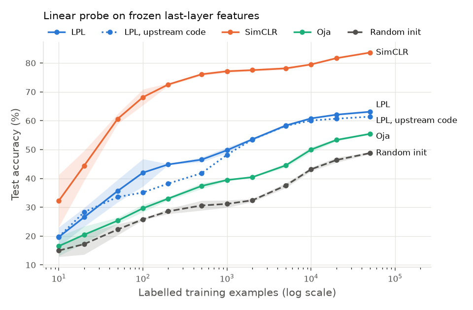
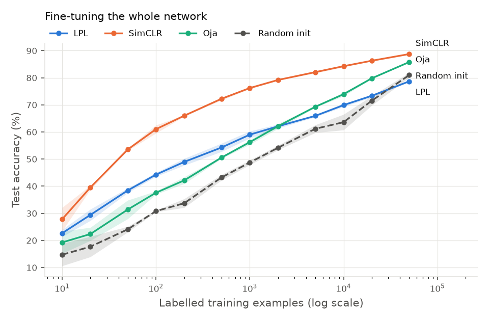

# PREWIRE: Prior Wiring for Efficient Representation Learning

How much labelled data does a brain-like learning rule save? We pre-train a network on CIFAR-10
photos **without labels** using Latent Predictive Learning (LPL; Halvagal & Zenke, 2023,
*Nature Neuroscience*), and compare it with three alternatives:

- Oja's rule, a simpler brain-like rule;
- SimCLR, a strong standard method that is not brain-like;
- no pre-training at all (random initialisation).

We then measure how well each network classifies the photos when only 10 to 50,000 labelled
examples are available. A second experiment turns each photo into a short synthetic "video" to
test whether smooth change over time is what makes LPL work.

CS6251 Computational Models of Cognition, IIT Madras (Prof. Sutanu Chakraborti).
Shivan Ajay Iyer and Aditya Suhas Tamras.

**Start here:**

- Report: [docs/PREWIRE_Report.pdf](docs/PREWIRE_Report.pdf)
- Slides: [docs/PREWIRE_Slides.pptx](docs/PREWIRE_Slides.pptx)
- What every figure shows, in plain language: [results_and_figs/figure_interpret.md](results_and_figs/figure_interpret.md)
- Full log of results and decisions, newest first: [docs/update.md](docs/update.md)

## Key takeaways

All four methods use the same network (VGG-11), the same 50,000 unlabelled photos and the same
training budget, so they differ only in the learning rule. Each network is tested in two ways:

- **Linear probe:** the network is frozen, and only a simple classifier on top is trained. This
  measures how good the learned features are as they stand.
- **Fine-tuning:** the whole network is trained further on the labels. This measures how good a
  starting point the pre-training gives.

Results are means of 3 seeds, scored on the 10,000 CIFAR-10 test photos. Accuracy in %:

| Labelled examples | Probe: 100 | Probe: 1,000 | Probe: 50,000 | Fine-tune: 100 | Fine-tune: 1,000 | Fine-tune: 50,000 |
| --- | --- | --- | --- | --- | --- | --- |
| SimCLR (not brain-like) | 68.2 | 77.1 | 83.6 | 61.0 | 76.2 | 88.8 |
| LPL | 42.0 | 49.8 | 63.1 | 44.3 | 59.0 | 78.7 |
| Oja | 29.6 | 39.4 | 55.4 | 37.6 | 56.2 | 85.8 |
| Random init (no pre-training) | 25.8 | 31.2 | 48.8 | 30.8 | 48.8 | 81.0 |

1. **LPL's prior is worth a lot of labels.** With only 1,000 labels, LPL's frozen features (49.8%)
   beat untrained features given all 50,000 labels (48.8%). Our re-implementation matches Zenke's
   original code on the same test.
2. **When the whole network is fine-tuned, LPL's head start is smaller and fades with more
   labels.**
   - LPL with 100 labels does as well as training from scratch with about 570 labels (≈6×).
   - With 1,000 labels, it matches about 3,800 (≈4×).
   - At 50,000 labels, starting from LPL is slightly *worse* than starting from scratch
     (78.7 vs 81.0%, on every seed).
3. **A strong prior helps most when data is scarce; a weak one adapts better when data is
   plentiful.** Oja's simpler features help at every label count under fine-tuning and overtake
   LPL from about 5,000 labels (85.8% at 50,000).
4. **"Same object, slightly changed" is the essential ingredient.** If LPL is trained on pairs of
   *different* photos, it ends up below the untrained network.
5. **Smooth change over time helps, up to a point.** LPL on synthetic clips with frame-to-frame
   smoothness ρ = 0.8 beats independent frames (54.6 vs 49.7% at 1,000 labels, probe). Very smooth
   clips (ρ = 0.95) are worse again. Shuffling the frame order matters little. These runs are
   single seed.
6. **Being brain-like has a price.** SimCLR, which uses end-to-end backpropagation, is far ahead
   at every label count.

<p align="center">
  
  
</p>

## Finding your way around

| I want to… | Look in |
| --- | --- |
| Read the write-up or see the talk | [docs/](docs/): report (PDF), slides (PPTX) |
| See the figures | [results_and_figs/figures/](results_and_figs/figures/) (PDF for print, PNG for slides) |
| Understand a figure | [results_and_figs/figure_interpret.md](results_and_figs/figure_interpret.md) |
| Get the raw numbers | [results_and_figs/tables/](results_and_figs/tables/): `results_summary.csv` (mean, SD per method and label count), `data_equivalence.csv` (labels saved vs random init), per-seed `linear_probe_s*.csv` and `finetune_s*.csv` |
| Know what was run, when and why | [docs/update.md](docs/update.md) |
| See the learning rules | [src/learning_rules/](src/learning_rules/): `lpl.py`, `oja.py`, `simclr.py` |
| See how the synthetic clips are made | [src/data/sequences.py](src/data/sequences.py) and [src/data/augmentations.py](src/data/augmentations.py) |
| See how networks are scored | [scripts/linear_probe.py](scripts/linear_probe.py), [scripts/finetune.py](scripts/finetune.py), [src/analysis/](src/analysis/) |
| Change an experiment's settings | [configs/](configs/): `base.yaml` plus one file per condition |
| Know the design decisions and conventions | [CLAUDE.md](CLAUDE.md) |

## Repository layout

| Path | Contents |
| --- | --- |
| `src/` | Importable package: models, data loaders, learning rules, analysis |
| `scripts/` | Entry points (pre-train, fine-tune, evaluate, plot), run from the repo root |
| `configs/` | YAML configs: `base.yaml` plus one file per condition |
| `tests/` | pytest suite, including the parity test of our LPL against upstream's |
| `cluster/` | PBS job scripts for the AQUA cluster |
| `vendor/lpl_zenke/` | Upstream LPL code, unmodified; `VERSION.txt` records the commit |
| `results_and_figs/` | Figures, tables and the figure guide; checkpoints (gitignored) |
| `docs/` | Report, slides, update log, proposal and working summary |
| `data/` | Datasets (gitignored) |

## Setup

There are two Python environments, because upstream LPL needs an old library stack (torch 1.11,
pytorch-lightning 1.6) that does not install on Python 3.11.

| Env | Python | Used for |
| --- | --- | --- |
| `.venv` | 3.11 | Our pipeline (`src/`, `scripts/`) |
| `.venv-upstream` | 3.10 | Running upstream LPL as-is, and the parity test for our LPL re-implementation |

Commands below are for Windows (PowerShell or Git Bash), run from the repo root.

**Main env.** Versions are pinned in `requirements.txt`. torch comes from the CUDA 11.8 index
(laptop and cluster). The editable install makes `src` importable from `scripts/` and `tests/`.

```bash
py -3.11 -m venv .venv
.venv/Scripts/python -m pip install torch==2.6.0 torchvision==0.21.0 --index-url https://download.pytorch.org/whl/cu118
.venv/Scripts/python -m pip install -r requirements.txt
.venv/Scripts/python -m pip install -e .
.venv/Scripts/pytest            # 46 tests (augmentations, learning rules, LPL parity, evaluation)
```

**Legacy env (upstream LPL).** pytorch-lightning 1.6.1 has package metadata that pip 24.1 and
later reject, so pip is held below 24.1.

```bash
py -3.10 -m venv .venv-upstream
.venv-upstream/Scripts/python -m pip install "pip<24.1"
.venv-upstream/Scripts/python -m pip install -r vendor/lpl_zenke/requirements-legacy.txt \
    --extra-index-url https://download.pytorch.org/whl/cu113
```

**Low disk space on the system drive.** pip unpacks torch (about 2 GB) into the temp folder and
caches it. If the system drive is nearly full, keep the repo on a larger drive and point pip there:

```bash
TMP="$PWD/.venv-upstream/piptmp" TEMP="$PWD/.venv-upstream/piptmp" \
    .venv-upstream/Scripts/python -m pip install --no-cache-dir -r ...
```

## Running upstream LPL

Upstream uses top-level imports (`from models.encoders import ...`), so it runs from inside
`vendor/lpl_zenke/`. It reads and writes `~/data/datasets` and `~/data/lpl`. To keep those inside
the repo's `data/` folder, point the home directory at `data/upstream_home` (on Windows, Python
reads `USERPROFILE`):

```bash
cd vendor/lpl_zenke
USERPROFILE="$(cd ../.. && pwd)/data/upstream_home" HOME="$(cd ../.. && pwd)/data/upstream_home" \
    ../../.venv-upstream/Scripts/python lpl_main.py \
    --batch_size 64 --num_workers 0 --max_steps 60 --experiment_name smoke
```

This is a 60-step smoke test (about 20 s of training on an RTX 3060 laptop GPU, plus a short
linear-readout evaluation at the end).

- `--max_steps 60`: Lightning logs every 50 steps, so shorter runs record no per-layer losses.
- `--num_workers 0`: avoids slow worker start-up on Windows.
- Don't add `--verbose_printing` to a run that stops mid-epoch: its table printer crashes
  (`KeyError: 'Layerwise validation losses/...'`) because no validation metrics exist yet.
- Upstream refuses to overwrite an existing experiment. Delete
  `data/upstream_home/data/lpl/cifar10/smoke/` or change `--experiment_name` before re-running.
- Outputs (TensorBoard log, checkpoint) go to `data/upstream_home/data/lpl/cifar10/<experiment_name>/`.

CIFAR-10 is expected at `data/upstream_home/data/datasets/cifar10/`; upstream downloads it there if
it is missing. The download URL has moved to `https://cave.cs.toronto.edu/kriz/cifar-10-python.tar.gz`
(MD5 `c58f30108f718f92721af3b95e74349a`). The server can't resume interrupted downloads.

## Running our pipeline

Scripts run from the repo root with a condition config (`configs/*.yaml`, merged over
`configs/base.yaml`). See [CLAUDE.md](CLAUDE.md) for the conditions.

**Pre-training** (`lpl`, `simclr`, `oja`, `random_init`, `lpl_shuffled`, `lpl_temporal`):

```bash
python scripts/pretrain.py --config configs/lpl.yaml
python scripts/pretrain.py --config configs/lpl.yaml --run_name pilot_lpl     --set pretrain.max_steps=3000 pretrain.frames_per_step=1024   # overrides
```

- Outputs go to `$PREWIRE_OUT/<run_name>/` (default `results_and_figs/checkpoints/<run_name>/`):
  `state.pt` (full training state, every `ckpt_every` steps), `metrics.csv`, and `encoder.pt`
  when finished. Re-running resumes from `state.pt`; a finished run exits immediately.
- Metrics also go to MLflow (`./mlruns` unless `MLFLOW_TRACKING_URI` is set):
  `mlflow ui --backend-store-uri ./mlruns` with `MLFLOW_ALLOW_FILE_STORE=true`.
- An online linear probe (10k train / 10k test images, frozen last-layer features) is logged
  every `probe_every` steps as `probe_acc`.
- On the laptop GPU (6 GB), 1024 frames per step takes ~0.17 s (LPL) to ~0.23 s (SimCLR).

**Cluster (AQUA).** `cluster/submit.sh` submits a chain of PBS jobs for one config (see
`CLUSTER.md`, kept out of git), e.g. `bash cluster/submit.sh configs/lpl.yaml`;
`AFTER=<jobid>` makes the first link wait for another job to succeed.
`cluster/upstream_lpl.cmd` runs upstream LPL unmodified as a reference.

- Code: `~/prewire` (deploy key, `git pull` sometimes needs a retry). Data:
  `~/scratch/prewire/cifar10/`. Outputs: `~/prewire_out/<run_name>/`. Logs: `~/prewire/logs/`.
- Env `~/envs/prewire`: torch 2.6.0+cu118 as on the laptop; CentOS 7 has no builds of the newer
  numpy/scipy/pandas pins, so those are the newest available there, and MLflow is
  `mlflow-skinny`. Install with `--prefer-binary`; expect ~2 h on Lustre.
- Speed on a V100 at 2048 frames/step: LPL 0.135 s, SimCLR 0.161 s, Oja 0.093 s.

**Evaluation (laptop).** Every network is scored with a linear probe and by fine-tuning, at 12
labelled-set sizes (10 to 50,000; class-balanced, nested, chosen by the seed). See
[CLAUDE.md](CLAUDE.md) for the protocol.

```bash
python scripts/convert_upstream.py <upstream.ckpt> results_and_figs/checkpoints/zenke_reference
bash scripts/evaluate_all.sh          # all probes + fine-tunes (~6 h on an RTX 3060 laptop GPU)
python scripts/plot_results.py        # figures + tables, averaged over seeds
```

- Single runs: `python scripts/linear_probe.py --encoders lpl=results_and_figs/checkpoints/lpl_s0
  --seed 0` (add `--layers 8` for the last layer only); `scripts/finetune.py` takes the same
  `--encoders` and `--seed` arguments.
- Results are appended to `results_and_figs/tables/{linear_probe,finetune}_s<seed>.csv`.
  `plot_results.py` writes dated PDFs and PNGs to `results_and_figs/figures/`, plus
  `results_summary.csv` and `data_equivalence.csv` (how many labels each method is worth,
  relative to random init).
- Don't edit `evaluate_all.sh` while it runs: bash reads scripts as it goes.

**Other tools.**

- `python scripts/preview_clips.py --rhos 0 0.5 0.8 0.95` renders example synthetic clips to
  `results_and_figs/figures/`.
- CIFAR-10 is read from `$PREWIRE_DATA/cifar10/cifar-10-batches-py`. Without `PREWIRE_DATA` it
  defaults to `data/upstream_home/data/datasets/`, the copy upstream also uses.

## Documentation

All documents (report, slides, proposal, update log) live in `docs/`. After each milestone,
experiment or discovery, add an entry to the top of [docs/update.md](docs/update.md).

## Licence

`vendor/lpl_zenke/` is MIT-licensed by its authors (see `vendor/lpl_zenke/LICENSE`).
